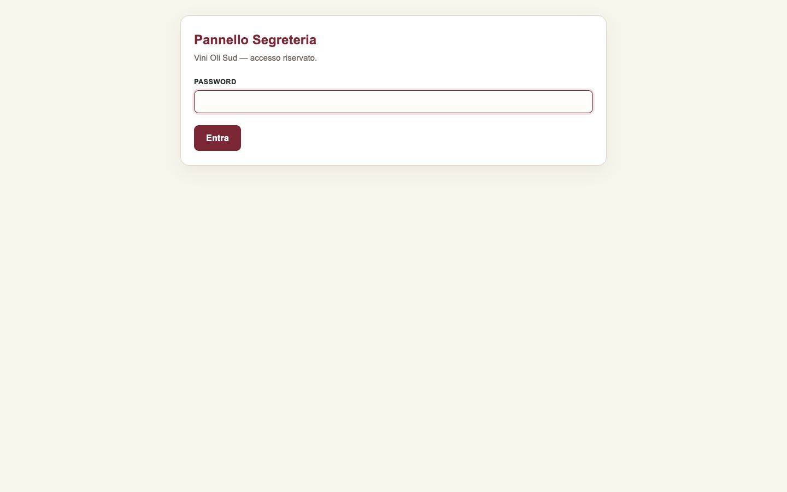
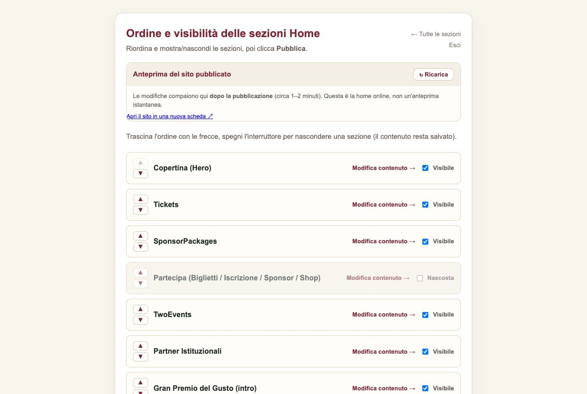

# Vini Oli Sud Web

[](https://github.com/ediriv22/vini-oli-sud-web/actions/workflows/ci.yml) [](https://github.com/ediriv22/vini-oli-sud-web/actions/workflows/deploy.yml) 

Website and editorial portal for **Vini Oli Sud**, live at [vinisud.it](https://www.vinisud.it).
Content is in Italian. The site is a static Next.js export, deployed automatically to shared hosting, with a small PHP admin panel so non-technical staff can edit content without touching code.

## Screenshots

<p>
  
  
</p>

The admin panel used by the organisers' office (no code, no Node.js on the server):

<p>
  
  
</p>

## Stack

- Next.js 16 (App Router, static export), React 19, TypeScript, Tailwind CSS 4
- PHP admin panel (`public/admin`) and form handlers (`public/forms`)
- GitHub Actions for build, PHP lint and FTPS deploy to Aruba hosting

## How it fits together

```
 staff edits in /admin (PHP)
        │  saves JSON through the GitHub Contents API (one commit per publish)
        ▼
 GitHub repo (main) ──► GitHub Actions: npm ci, next build, php -l, FTPS deploy
                                        │
                                        ▼
                              static files on Aruba (out/)
```

- Editable content lives in `content/settings/*.json` (site settings, home sections, section order and visibility).
- The admin panel needs no database and no Node.js on the server. It is protected by a password and stores nothing but commits.
- The deploy workflow refuses to publish if any PHP file fails `php -l`, and never overwrites server-side config such as `forms/config.php`.

Docs: [CMS setup](docs/CMS_SETUP.md) · [visual editor](docs/EDITOR-VISUALE.md) · [staff guide](docs/GUIDA-SEGRETERIA.md) · [news radar workflow](docs/food-radar-workflow.md)

## Tests and checks

```bash
npm test          # 17 tests, Node's built-in runner, no extra dependencies
npm run lint
npx tsc --noEmit
```

- `tests/admin.test.mjs` serves the real PHP panel with a throwaway config and checks login, wrong passwords, session cookie flags, CSRF protection and the login rate limit (needs PHP).
- `tests/radar.test.mjs` runs the news radar importer on good and bad data: validation, duplicates, the 30 item cap and error exits.
- `tests/content.test.mjs` checks that the JSON edited by the staff stays valid and that every image or file it points to exists.
- GitHub Actions: `ci.yml` (lint, types, build, PHP lint, tests, `npm audit` on production dependencies) on every push, `pr-check.yml` on pull requests, `deploy.yml` to publish. Deploys are never blocked by the checks, so the office can always publish.

## Run locally

```bash
npm install
npm run dev        # http://localhost:3000
npm run lint
npm run build      # static export in out/
```

Node 20 to 22 (see `.nvmrc`). To try the admin panel locally you also need PHP:

```bash
cp public/admin/config.example.php public/admin/config.php   # fill in dummy values
php -S localhost:8080 -t public
```

`config.php` files are git-ignored and excluded from deploys. Real credentials only ever live on the server and in GitHub Secrets.

## Structure

```
src/app/          routes (home, format, programme, jury pass, rules and prizes, sponsors, winners)
src/components/   layout, sections and UI components
src/data/         brand, navigation and page data
public/admin/     PHP admin panel
public/forms/     PHP form handlers (lead capture, payments)
content/settings/ JSON edited from the admin panel
scripts/          import tools for the news radar
.github/workflows/deploy.yml
```

## Licence

All rights reserved. The code is public for evaluation only and may not be reused. See [LICENSE](LICENSE). Brand assets belong to Vini Oli Sud and their respective owners.
